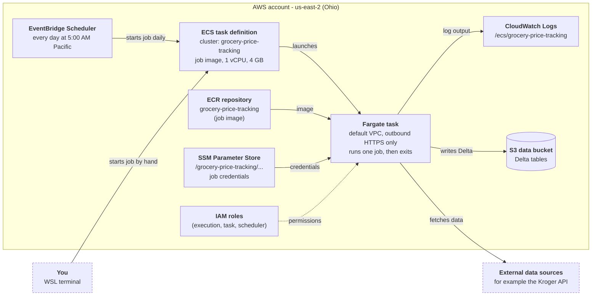

# Infrastructure

Terraform for the project's AWS resources. Names and tags follow [NAMING.md](NAMING.md).

## Architecture

What exists in AWS today (region us-east-2). Nothing here runs between jobs: a Fargate task exists only while
a job runs, then exits. A daily schedule starts the job; you can also start it by hand.



Dashed boxes are outside AWS, and the dotted arrow is the IAM roles around the task: an execution role (ECS
uses it to pull the image, read the secrets and write logs), a task role (the job's own access to the data
bucket) and a scheduler role (lets EventBridge Scheduler start the task, nothing else).

Terraform creates everything in the AWS account except the SSM secrets, which are entered by hand (see below).

| Path | What |
|---|---|
| `main.tf`, `variables.tf`, `outputs.tf` | The project's resources (data bucket). State lives in S3. |
| `jobs.tf` | The job: ECR repository, ECS cluster, Fargate task definition, roles, log group. |
| `schedule.tf` | The daily schedule (EventBridge Scheduler) and the role it uses to start the job. |
| `bootstrap/` | One-time setup: state bucket and the release IAM user. Local state. |
| `../.github/workflows/release.yml` | Manual pipeline: plan, and optionally apply, behind an approval. |

## One-time setup

Run these from the repository root; `-chdir` avoids changing directories.

1. Sign in locally (`aws sts get-caller-identity` should work), then create the state bucket and the release IAM user:
   ```
   terraform -chdir=infra/bootstrap init
   terraform -chdir=infra/bootstrap apply
   ```
   Keep `infra/bootstrap/terraform.tfstate`; it is gitignored.
2. State is already in the S3 bucket. On a fresh clone, `terraform -chdir=infra init` connects to it.
3. Create an access key for the release user (not through Terraform, so the secret stays out of state):
   ```
   aws iam create-access-key --user-name grocery-price-tracking-github-release
   ```
   Copy `AccessKeyId` and `SecretAccessKey` straight into step 4; they are not shown again.
4. In GitHub, **Settings > Environments**, create `production`, add yourself as a required reviewer, and add
   two **environment secrets**: `AWS_ACCESS_KEY_ID` and `AWS_SECRET_ACCESS_KEY`. Environment secrets are only
   released to a job after the reviewer approves.

Rotate the key now and then: create a new one, update the secrets, then
`aws iam delete-access-key --user-name grocery-price-tracking-github-release --access-key-id <old id>`.

## The job (ECS Fargate)

`jobs.tf` runs the image built from the repository's `Dockerfile` as a one-off Fargate task that
exits when the job is done (see Architecture above). The task gets a public IP in a default-VPC subnet
(outbound HTTPS only), so no NAT gateway is needed.

Set it up once, in this order (run from the repository root):

1. **Permissions.** The release user needs the ECR/ECS/IAM permissions added in `bootstrap/main.tf`.
   Apply them locally first, as with any new kind of resource:
   ```
   terraform -chdir=infra/bootstrap apply
   ```
2. **Create the resources:** `terraform -chdir=infra apply` (or run **Release** with apply ticked).
3. **Store the Kroger credentials** in SSM Parameter Store. This is done by hand, not in Terraform,
   so the values stay out of state. Copy them from your `.env` instead of retyping them (a typo gives a
   `401` from Kroger when the job runs). The subshell keeps the values out of your shell afterwards, and
   each command prints the new parameter version (`1` the first time):
   ```
   (
     set -a; source .env; set +a
     aws ssm put-parameter --region us-east-2 --type SecureString --overwrite \
         --name /grocery-price-tracking/kroger/client_id --value "$KROGER_CLIENT_ID" \
         --query Version --output text
     aws ssm put-parameter --region us-east-2 --type SecureString --overwrite \
         --name /grocery-price-tracking/kroger/client_secret --value "$KROGER_CLIENT_SECRET" \
         --query Version --output text
   )
   ```
4. **Push the image** (about 2 GB compressed, so the first push takes several minutes). You only need this by
   hand for the very first deploy or to try an image without a Release; after that, **Release** builds and
   pushes it (see Day to day). A local `terraform apply` without `image_tag` points the task definition at
   `latest`, and the next Release moves it back to the commit tag:
   ```
   REPO=$(terraform -chdir=infra output -raw ecr_repository_url)
   aws ecr get-login-password --region us-east-2 | docker login --username AWS --password-stdin "${REPO%%/*}"
   docker build -t grocery-price-tracking .
   docker tag grocery-price-tracking "$REPO:latest"
   docker push "$REPO:latest"
   ```

Run the job and read its logs. A run takes a few minutes, most of it pulling the image and starting
Spark, and costs well under a cent:
```
aws ecs run-task --region us-east-2 --launch-type FARGATE \
    --cluster "$(terraform -chdir=infra output -raw ecs_cluster_name)" \
    --task-definition "$(terraform -chdir=infra output -raw task_definition_family)" \
    --network-configuration "$(terraform -chdir=infra output -raw task_network_configuration)"
aws logs tail "$(terraform -chdir=infra output -raw log_group_name)" --region us-east-2 --follow
```
A task that fails to start (for example, the image or a secret is missing) shows the reason under
`aws ecs describe-tasks`, in `stoppedReason`.

### The daily schedule

`schedule.tf` starts the job every day at **5:00 AM Pacific** (`America/Los_Angeles`, so it follows daylight
saving time). It names the task definition without a revision, so it always runs the newest one: a Release that
pushes a new image is picked up by the next run, with no change to the schedule. Running the job twice in a day
is harmless, because each write replaces that day's partition.

- **Check it:** in the AWS console, open **EventBridge Scheduler** (region us-east-2) and look at
  `grocery-price-tracking-job-daily`, or look in the cluster's **Tasks** tab (stopped tasks) after 5 AM.
- **Pause it:** set `schedule_enabled` to `false` (default in `variables.tf`) and apply. Disabling it only in
  the console is undone by the next Release, which re-applies the Terraform.
- **Change the time:** edit `schedule_expression` in `schedule.tf`. It is a cron expression in the schedule's
  time zone.
- **A failed run is not reported anywhere.** Look at the cluster's stopped tasks, or the log group. An email
  alert (EventBridge rule plus SNS) can be added if you want one.

To remove everything the job created: `terraform -chdir=infra destroy` (the repository is deleted
with its images), then delete the two SSM parameters by hand.

## Day to day

Run **Release** from the GitHub Actions tab (**Run workflow**) and approve the `production` deployment.
The plan appears in the job summary. The run only plans unless **apply** is ticked.

Ticking **apply** also builds the job image from the `Dockerfile` and pushes it to ECR tagged with the commit
SHA (the build and upload take several minutes), then applies the plan, which points the task definition at
that exact image. So deploying a code change is one Release run, with no manual push. The pushed tag appears
in the run's summary, and ECR keeps the 10 newest images.

The release user is scoped to this project's resources. When `infra/` starts managing other kinds of resources,
add the permissions to `bootstrap/main.tf` and apply `bootstrap` locally first.
